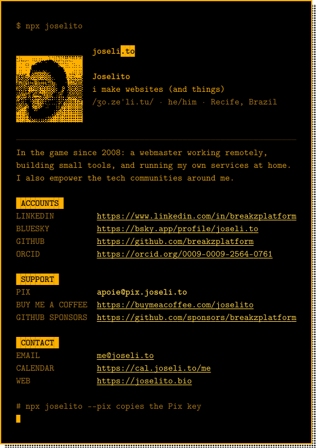

<a href="https://joselito.bio">
  <picture>
    <source media="(prefers-color-scheme: dark)" srcset="assets/card-dark.svg">
    
  </picture>
</a>

&nbsp;

My business card, right in your terminal.

```sh
npx joselito
```

[](https://github.com/breakzplatform/card/actions/workflows/ci.yml)
[](https://www.npmjs.com/package/joselito)

## Accounts

[LinkedIn](https://www.linkedin.com/in/breakzplatform) · [Bluesky](https://bsky.app/profile/joseli.to) · [GitHub](https://github.com/breakzplatform) · [ORCID](https://orcid.org/0009-0009-2564-0761)

## Support

<picture>
  <source media="(prefers-color-scheme: dark)" srcset="assets/qr-dark.svg">
  
</picture>

**Pix key (email)**, or run `npx joselito --pix` to copy it

```
apoie@pix.joseli.to
```

<a href="https://buymeacoffee.com/joselito">
  <picture>
    <source media="(prefers-color-scheme: dark)" srcset="assets/coffee-dark.svg">
    
  </picture>
</a>
<br>
<a href="https://github.com/sponsors/breakzplatform">
  <picture>
    <source media="(prefers-color-scheme: dark)" srcset="assets/sponsors-dark.svg">
    
  </picture>
</a>

## Contact

[me@joseli.to](mailto:me@joseli.to) · [cal.joseli.to/me](https://cal.joseli.to/me) · [joselito.bio](https://joselito.bio)

## Options

| Flag | Description |
| --- | --- |
| `--lang pt` | Print the card in Portuguese |
| `--pix` | Copy the Pix key to the clipboard |
| `--no-color` | Print plain text, no colors and no image |
| `--image <mode>` | Avatar image: `auto` (default), `kitty`, `iterm` or `off` |
| `-h`, `--help` | Show usage |

Colors are on in a TTY and off when piped. `NO_COLOR` and `FORCE_COLOR` are honored. In terminals that support them, links are clickable.

The card follows the terminal theme of the joseli.to design system: amber on black, in truecolor when `COLORTERM` is `truecolor` or `24bit` and in the nearest 256 colors otherwise.

### Inline avatar

Terminals with inline images show the avatar inside the card:

- kitty graphics protocol: kitty, Ghostty
- iTerm2 inline images: iTerm2, WezTerm

Everywhere else, and always when piped, with `NO_COLOR`/`--no-color`, inside tmux or screen, or when the window is too short for the card, the card is text only. The image is a 2 KB PNG embedded in [`src/avatar.js`](src/avatar.js), so the card works offline.

### Copying the Pix key

`--pix` sends the key through OSC 52 on terminals known to accept it (kitty, Ghostty, WezTerm, Windows Terminal, Alacritty, foot) and over SSH. Locally it also tries `pbcopy`, `clip.exe`, `wl-copy`, `xclip` and `xsel`. The key is always printed, so it can be copied by hand when nothing works.

## Development

Requires Node.js 20 or newer. There are no runtime dependencies.

```sh
node bin/card.js    # print the card
npm test            # run the tests
npm pack && npx ./joselito-*.tgz   # try the published package locally
```

The card content lives in [`src/data.js`](src/data.js) and mirrors [joselito.bio](https://joselito.bio). The layout is in [`src/render.js`](src/render.js), terminal detection in [`src/terminal.js`](src/terminal.js) and the clipboard in [`src/clipboard.js`](src/clipboard.js).

Generated files:

- `src/avatar.js`: `scripts/build-avatar.sh` (needs ImageMagick)
- `assets/card.svg`, `assets/card-dark.svg`: `uv run --with fonttools --with brotli scripts/build-readme-svg.py`, after any change to the card

The Pix QR code and the support buttons come from [pix.joseli.to](https://github.com/breakzplatform/pix.joseli.to).
